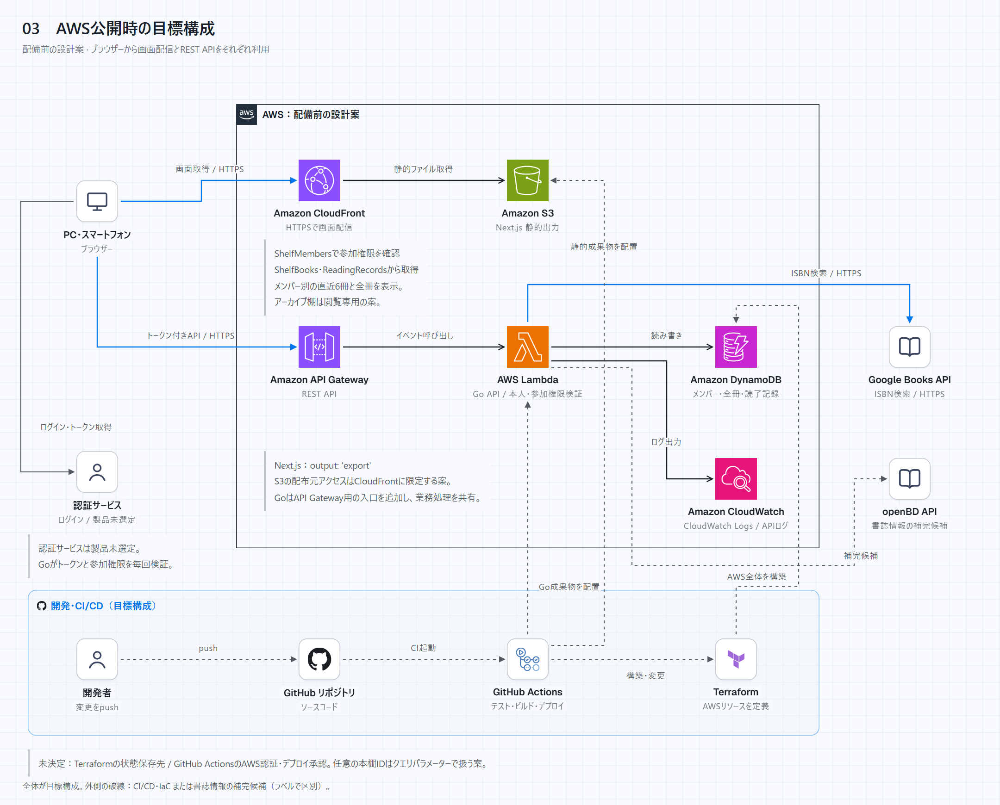
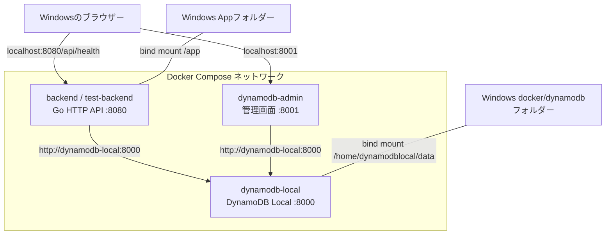
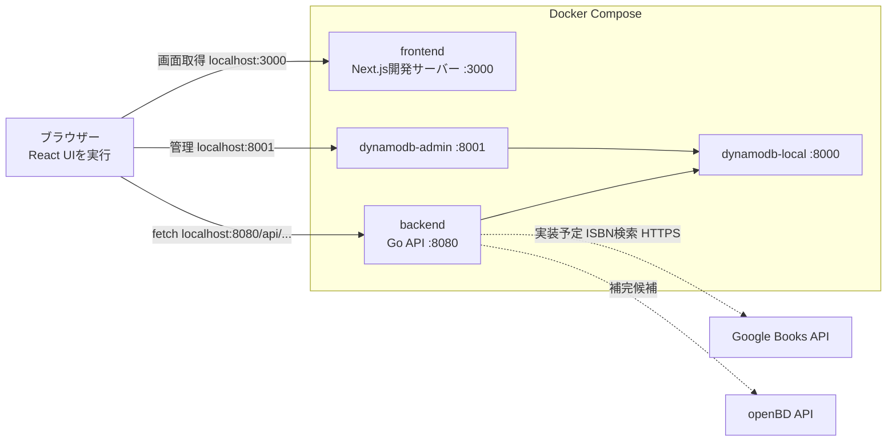
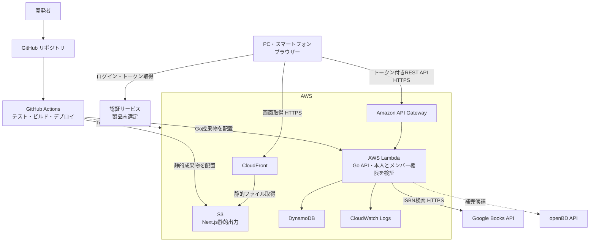

# 2D仮想本棚 構成図

版 0.2 ／ 更新日 2026-11-05 ／ 共同本棚向け設計案

[拡大・テーマ切替用HTML](diagrams/03-aws-target.html) · [ダーク版PNG](diagrams/03-aws-target-dark.png)

## 1. バックエンド開発開始時のローカル構成

フロント追加前の3サービス構成。実線は通信またはフォルダー共有を表す。

コンテナ内のlocalhostはそのコンテナ自身を指す。GoからDBへはComposeのサービス名で接続する。コードは共有されるが、現在の起動コマンド `go run main.go` では編集後にbackendの再起動が必要。

## 2. 現在のローカル開発構成

frontendを追加済み。接続確認画面はブラウザーからGo APIを呼び出す。共同本棚モックはメンバー別の直近6冊、全冊ライブラリ、読了表示まで作成済み。モックはブラウザー内のサンプルデータで動き、業務API・認証・外部書誌APIは未接続。

Goは開発画面のオリジンからの通信をCORSで許可する。スマートフォン実機から試す場合は、API接続先を開発PCの到達可能なアドレスに切り替える。カメラ検証時のHTTPS接続は別途準備する。

## 3. AWS公開時の目標構成

配備前の設計案。ログインでユーザーを識別し、APIで対象の共同本棚への有効な参加権限を毎回確認する。認証サービスの製品は未選定。フロントの静的ファイルに個人データを含めず、本棚データは認証・認可されたAPIから取得する。

Next.jsは `output: 'export'` で静的ファイルを生成し、S3とCloudFrontで配信する。動的データはブラウザーからGo APIへ問い合わせる。任意の本棚IDはクエリパラメーターで扱う案とし、静的生成できない動的パスへの依存を避ける。[Next.js公式資料](https://nextjs.org/docs/app/guides/static-exports)

ローカルのGo HTTPサーバーをLambdaで動かす際は、API Gatewayイベントを受け取るエントリーポイントを追加し、業務処理を共有する。S3の配布元アクセスはCloudFrontに限定する案。Terraformの状態保存先とGitHub ActionsのAWS認証・デプロイ承認はAWS準備時に設計する。

## 4. 採用技術と役割

| 技術 | 役割 |
| --- | --- |
| React・TypeScript・Next.js | 本棚表示、操作、静的フロントエンド |
| Go | 入力検証、書誌検索、登録本・読書状態の管理 |
| DynamoDB Local / DynamoDB | 開発時 / AWS上の永続化 |
| Lambda・API Gateway | Go APIの実行とHTTPSエンドポイント |
| S3・CloudFront | フロントエンド配信 |
| Terraform | AWSリソースの定義 |
| GitHub Actions | 自動テスト・ビルド・デプロイ |
| CloudWatch Logs | AWS上のAPIログ |
| 認証サービス・製品未選定 | 本人確認とトークン発行 |

## 5. 共同本棚のデータと権限

ブラウザーは同じ登録本から、各メンバーの直近6冊と全冊ライブラリを表示する。GoはShelfMembersで参加権限を検査し、ShelfBooksとReadingRecordsを取得する。アーカイブ棚は閲覧専用とする案。

Goの入口でトークンの署名・発行者・対象・有効期限を検証し、認証主体からuserIdを確定する。API Gatewayでのトークン検証を採用する場合も、本棚メンバー確認はGoに残す。アカウント識別と棚へのアクセス権を両方検証する。

ローカルの複数人検証は開発専用ユーザー切替を導入する案。AWSではこの開発用識別を受け付けない。まだ実装していない機構であり、認証方式確定後に構成と設定を具体化する。
