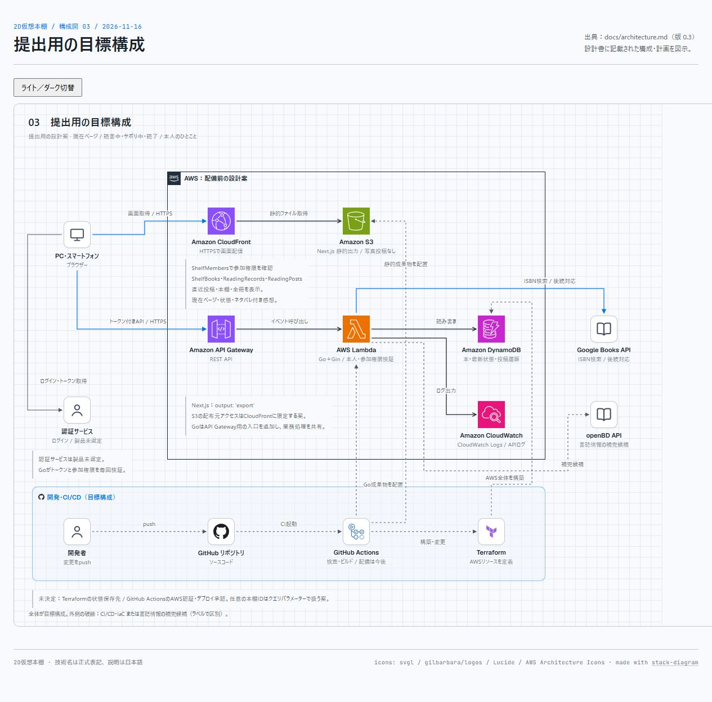

# 構成図 — 提出用の目標と現在
版 0.4 ／ 2026-11-17

## AWS公開の目標構成（未配備）

[拡大用HTML](diagrams/04-submission-target.html) · [ダーク版](diagrams/04-submission-target-dark.jpg)

技術構成は維持。フロントはNext.jsの静的出力、HTTP/APIはGo＋Gin、永続化はDynamoDB。
今回追加するのはReadingPostsとReadingRecordsのページ・状態であり、新しい実行サービスは不要。
S3は画面配信用。写真アップロード用バケット、返信、キャラのサービスは今回追加しない。

ブラウザー → CloudFront → S3で画面を取得。
ブラウザー → API Gateway → Lambda（Go＋Gin）→ DynamoDBでデータを取得・保存する計画。
LambdaではAPI GatewayイベントをGinに渡すアダプターまたは別の入口が必要。ローカルのrouter.Runだけでは配備できない。
本人確認は認証サービス（未選定）、参加権限と入力検証はGoで実施。静的ファイルに個人の本棚データを埋め込まない。
ISBN検索はGoogle Books APIを後続で追加、openBDは補完候補。未完成時も手入力で基本機能を利用できる。

## 現在のローカル構成
Docker Composeの4サービス:
| サービス | ポート | 役割 |
| --- | --- | --- |
| frontend | 3000 | Next.js。/mockは架空データによる操作見本 |
| backend | 8080 | Gin。healthと本のPOSTを登録済み |
| dynamodb-local | 8000 | Goが http://dynamodb-local:8000 で接続 |
| dynamodb-admin | 8001 | DB管理画面 |

コードはbind mountで共有するが、Go編集後はbackendの再起動が必要（go run .）。
healthは現在Goの応答のみ。CORS未設定のため別オリジンのフロント連携は要対応。
一覧取得のDB関数はあるがGETルートは未登録。投稿・認証は未実装。
最新の差分は [development-status.md](development-status.md)、DB関係は [data-model.md](data-model.md)。

## 提出時のデータの流れ（設計）
1. メンバーが本を手入力登録しShelfBooksへ保存。
2. 本を選び、現在ページ・状態・本人のひとこと・ネタバレ指定を送る。
3. Goが本人と本棚参加権限を確認し、ReadingPostsの履歴とReadingRecordsの最新値を同時保存。
4. フロントが直近投稿と全冊一覧を表示。ネタバレ本文は操作するまでDOMに出さない。
5. 古い投稿・本を削除せず、cursorで続きを取得する。

## CI/CDと公開準備
GitHub Actionsの現設定は検査・ビルド。自動デプロイは未実装。
Terraform、Lambda/S3配置、認証、状態保存先、OIDC等のAWS認証は配備準備時に具体化する。
AWS公開が提出必須か未確認。ローカルデモとインターネットへの共同公開を区別する。

## 旧図
01-initial-local、02-current-local、03-aws-targetは2026-11-05時点の資料として保存する。
現在ページを対象外にした旧ER図やアーカイブ必須案は、今回のrequirements.md / data-model.mdで置き換える。

## 2026-11-17 スマホUIへの対応
AWSの配信・実行サービスと上記構成図の接続は変更不要。DynamoDB内部に再送防止用RequestDedupを追加する目標とし、ReadingPosts・ReadingRecordsと同時保存する。画面は中央430px、みんな／記録する／本の3タブ。

[バックエンド実装計画](backend-plan.md) · [投稿保存の処理図](diagrams/reading-post-flow.svg)

この処理図は未実装の目標。固定本人によるローカルデモと、認証・参加権限を備えた公開版を分ける。インフラ図のDynamoDBノード内のテーブル詳細はdata-model.mdとsubmission-erを正とする。
