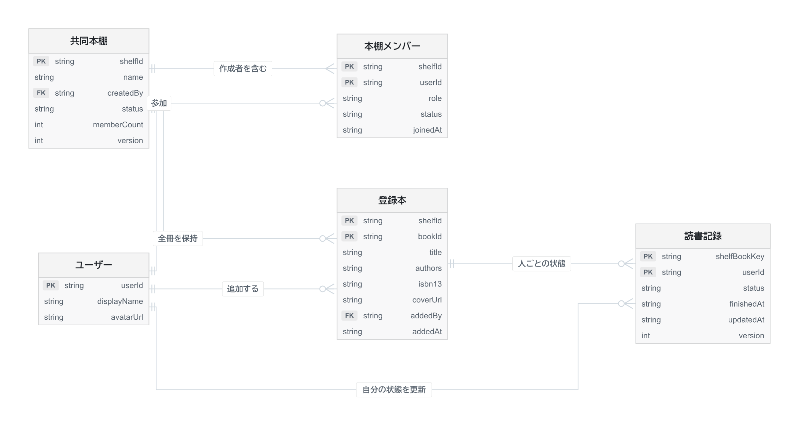

# 共同本棚 テーブルER図・データ設計
版 0.2 ／ 更新日 2026-11-05 ／ 業務DBは未実装

[編集用Mermaid](diagrams/data-model-ja.mmd) · [拡大用SVG](diagrams/data-model-ja.svg)

## データの単位

ユーザー・共同本棚・本棚メンバー・登録本・読書記録の5つを中心とする。作成者も本棚メンバーに含める。参加人数は1〜4人を仮案とする。

各人の段は、その人が追加した本の直近6冊を追加日時の降順で表示する。全冊ライブラリは同じ登録本を一覧表示する。6冊は表示上限であり、保存上限ではない。ライブラリ専用テーブルや古い本の移動処理は不要。

同じ登録本に対して各人の読書状態を持つ。Aが読了してもBの状態は変わらない。追加者と読了者を分ける。読書時間・速度・現在ページの属性は設けない。

## DynamoDBの物理テーブル案

| テーブル | PK | SK | 主な属性 |
| --- | --- | --- | --- |
| Users | userId | なし | displayName, avatarUrl, createdAt |
| Shelves | shelfId | なし | name, createdBy, status, memberCount, version, createdAt, archivedAt |
| ShelfMembers | shelfId | userId | role, status, joinedAt, leftAt, version |
| ShelfBooks | shelfId | bookId | isbn13, title, authors, coverUrl, source, addedBy, addedAt, version |
| ReadingRecords | shelfBookKey | userId | shelfId, bookId, status, finishedAt, updatedAt, version |

キーはString。shelfBookKeyはshelfIdとbookIdを「#」で連結した値。棚と本のIDは区切り文字を含まないUUID等を使う。userIdは検証済みの認証主体に対応させる。ER図のFKはアプリケーションが検証する論理参照。

書誌情報は外部API取得結果を登録本に保存する。書誌専用テーブル、metadataOverrides、固定のlibraryId=personalを廃止。同じISBNの重複登録ルールは未確定で、暫定的には独立したbookIdを持つ。

## 取得と索引

| 操作 | 方針 |
| --- | --- |
| 自分の参加棚 | ShelfMembersのGSIをPK=userId、SK=shelfIdとする。アクセス時は元テーブルの有効メンバーを再確認 |
| 全冊一覧 | ShelfBooksのGSIをPK=shelfId、SK=addedAt#bookIdとし、降順でカーソル取得 |
| 各人の直近6冊 | 別GSIをPK=shelfId#addedBy、SK=addedAt#bookIdとし、降順で6件取得 |
| 本詳細・更新 | 元テーブルのshelfIdとbookIdで取得 |
| 読了者・読書中の人 | 本ごとに最大4人分のReadingRecordsをBatchGetItem。未処理キーを再試行 |
| 検索・メンバー・読了絞り込み | 棚内の候補をページ走査し、書誌と読書記録を照合。結果数が満たされるか終端まで処理 |

GSI反映前の画面には更新APIの確定値を反映する。権限や更新条件は元テーブルで判定する。検索初期版はタイトル・著者の部分一致。量が増えたら検索索引を検討する。

モックは全件を持つため総ページ数を表示できる。本APIはカーソル方式とし、正確な件数を取得していない場合は総件数・総ページ数を推測表示しない。空のフィルター結果だけで走査完了と判断しない。

## 読書状態と履歴

レコードなしは未設定。statusはunread / reading / finished。本人だけが自分の状態を更新し、同じ棚のメンバーは読書中・読了した人を参照できる。

読了時にfinishedAtを保存し、再読でreadingに戻しても最後の読了日時を残す。「読了した本だけ」はfinishedAtがある本を対象とする。毎回の読了イベントを保存する履歴は将来拡張。複数冊を読書中にできる設計とし、モックの1冊切替は簡略化として扱う。

## 権限と整合性

- メンバーはactive / left、役割はowner / memberを仮案とする。脱退後も登録本・読了記録の参照関係を残す。
- 棚はactive / archived。アーカイブ時点の有効メンバーは閲覧でき、登録・編集・読書状態変更・招待を停止する。再開はownerが行う案。
- 棚作成とownerメンバー作成を同一トランザクションにする。
- 本の追加・読書状態更新時に、activeな棚と本人のactiveメンバーシップをトランザクション内で検査する。
- 参加処理では、人数上限の条件付き更新とメンバー作成を同一トランザクションにする。
- version条件で古い更新を拒否し、二重送信は同一リクエストIDで重複作成しない設計にする。
- 棚のアーカイブは状態更新だけで行い、本と読了記録を保持する。初期版の本削除APIは保留し、誤登録の訂正方法を別途決める。

招待方法は未確定。トークン方式なら有効期限・利用状態・対象を持つ補助テーブルを追加する。図は招待承諾後のメンバーを表す。編集権限、脱退、所有者移譲、アカウント削除は実装前に確定する。

## 検証

7冊目追加後も古い本を検索できること、A・Bの状態が独立すること、不参加者Cがアクセスできないこと、アーカイブ後の閲覧と更新拒否、同時参加時の人数制限、複数ページの検索、DB再起動後の永続化を確認する。

旧3テーブル案とは互換性のない設計改訂。実テーブル作成時に既存データの有無を確認し、必要なら移行を設計する。