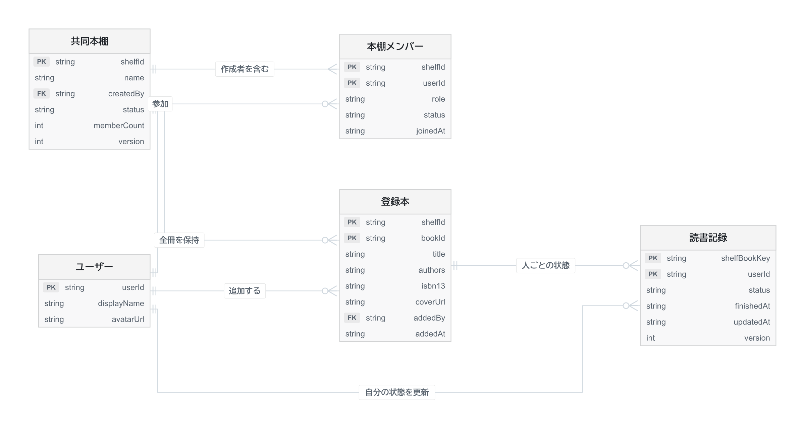

# 共同本棚ER図の読み方
更新日 2026-11-05 ／ 旧個人ライブラリ案から更新

本棚に参加する人を「本棚メンバー」で結び、本棚に追加した1冊を「登録本」に保存します。その本を誰が読んでいるかは「読書記録」に保存します。

例えばAが本を1冊追加し、AとBが読んだ場合、登録本は1件、読書記録は2件です。追加した人はAのまま、読了した人にはAとBの両方が表示されます。

直近6冊の段と全冊ライブラリは、同じ登録本の表示範囲を変えたものです。7冊目を追加しても古い本は残ります。棚のアーカイブ後も本と読了記録を残す案です。

[データ設計の全文](../data-model.md)