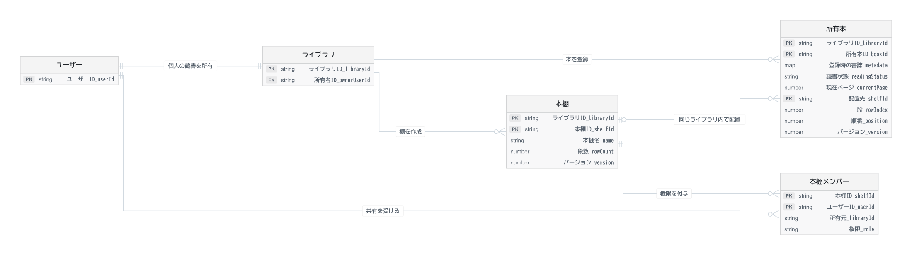

# 個人ライブラリと本棚共有の設計案

> 旧案。2026-11-05に共同本棚中心へ変更。最新の設計は [data-model.md](data-model.md) と [requirements.md](requirements.md) を参照。下記の個人ライブラリ方式は現在の実装方針に採用しない。

[2D仮想本棚のデータモデル](data-model.md)を複数ユーザー向けに拡張する案。ユーザーごとに個人ライブラリを1つ作り、共有はログイン済みの特定ユーザーに対して本棚単位で行う。

[拡大用SVG](diagrams/shelf-sharing-ja.svg) · [Mermaidソース](diagrams/shelf-sharing-ja.mmd)

## データの持ち方

| データ | 1件の意味 | キーの案 |
| --- | --- | --- |
| ユーザー | 認証された利用者 | ユーザーID |
| ライブラリ | その人の蔵書全体 | ライブラリID。初期版は所有者のユーザーIDから一意に決定し、二重作成を防ぐ |
| 本棚 | 個人ライブラリ内の棚 | ライブラリID＋本棚ID。本棚IDには全体で一意なUUIDを採用 |
| 所有本 | 登録した1冊。書誌、読書状態、任意の棚と位置を持つ | ライブラリID＋所有本ID |
| 本棚メンバー | あるユーザーが、ある棚に持つ権限 | 本棚ID＋共有先ユーザーID。対象棚を特定できるよう所有元ライブラリIDも保持 |

ISBN検索時は外部APIを呼び、利用者が登録を確定した時点で書名・著者・表紙URLなどを所有本の書誌属性に保存する。手入力も同じ構造で保存できる。同じISBNを2人が登録しても読書状態や書名の修正は独立する。共有した棚では、その所有本の書誌を表示するので、共有先ごとに本の複製を作る必要はない。

## 誰が何をできるか

| 操作 | 所有者 | 閲覧者（viewer） | 編集者（editor） |
| --- | --- | --- | --- |
| その棚の名前・段・配置・本の書誌を見る | 可 | 可 | 可 |
| その棚にある本を棚内で並べ替える | 可 | — | 可 |
| 本を登録・削除する、棚に追加する、棚から外す | 可 | — | — |
| 所有者の読書状態・現在ページを見る／変更する | 可 | — | — |
| 共有相手・権限の変更、共有解除、本棚削除 | 可 | — | — |

所有者はライブラリの所有者IDから判定する。所有者用のメンバー行は作らない。新規作成した棚は共有メンバーが0件のため本人専用になる。初期リリースでは閲覧共有から始め、共同編集を提供する時点で editor を有効にできる。

## 読み書きと検証

- **自分の蔵書**は、認証済みのユーザーIDから個人ライブラリを特定して取得する。
- **共有された棚の一覧**は、メンバーのユーザーIDをキーとする索引から棚を探す。棚の詳細を返す際は、その都度、対象棚の存在と現在の権限を確認する。共有解除後に古い一覧やURLから開いてもアクセスできないようにする。
- **共有の詳細画面**では、サーバーが対象の棚に配置された本だけを選び、書誌と位置を返す。所有本のレコード全体を返すと読書状態まで共有されるため、共有用の応答項目を明示する。
- **編集者の並べ替え**では、対象本の集合が現在の棚の内容と一致し、段・順番に重複がないことを確認する。書き込み時点でも編集権限と棚・本のバージョンを確認し、配置だけを一括更新する。別棚の本を指定した要求や、共有解除と競合した更新は拒否する。
- **削除**では、本棚を消しても所有本は未配置で個人ライブラリに残る。削除後は共有経由の読み書きを拒否し、対応するメンバー行を片付ける。

## 共同で本を持ち寄る場合

この案の「共有」は、本棚の所有者が選んだ本を他の人が見たり、棚内で並べ替えたりする機能。家族が**自分の所有本を同じ棚へ持ち寄り、自分の蔵書にも残す**要件では、棚と所有本の間に「棚への掲載」を追加する。掲載行に棚ID、所有元ライブラリID、所有本ID、段と順番を持たせる。読書記録は所有本に残し、共有棚から外す操作は掲載行の削除として扱う。持ち寄りが初回リリースの要件なら、この掲載モデルを最初から採用する。
